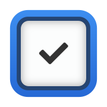
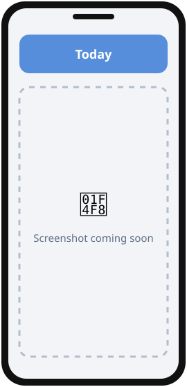
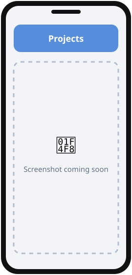
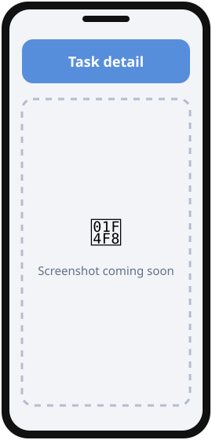

<div align="center">



# OnlyFlows

**An offline-first task & project manager for Android, synced over your own Wi-Fi.**

   

[](https://github.com/Iurika-N-T-R/OnlyFlows/releases/latest)
[](https://github.com/Iurika-N-T-R/OnlyFlows/releases)
[](LICENSE)
[](https://github.com/Iurika-N-T-R/OnlyFlows/stargazers)

[**⬇️ Download**](#download) · [**📸 Screenshots**](#screenshots) · [**✨ Features**](#features) · [**🛠️ Build**](#build)

</div>

---

<a id="screenshots"></a>

## 📸 Screenshots

<!-- TODO: replace docs/assets/screenshot-N.svg with real screenshots (same size for all, e.g. 1080x2400) -->
<div align="center">
<table>
  <tr>
    <td align="center"><br><sub><b>Today</b></sub></td>
    <td align="center"><br><sub><b>Projects</b></sub></td>
    <td align="center"><br><sub><b>Task detail</b></sub></td>
  </tr>
</table>
</div>

---

## 💡 What is OnlyFlows?

OnlyFlows helps **people who plan their days and projects** keep tasks, projects, notes and goals in one place,
**without an account, a cloud or a subscription**. Your devices sync with each other directly over your local network.
It is free, open source (GPLv3), works offline and contains no ads or trackers.

Inspired by [Things 3](https://culturedcode.com/things/), it goes further: goals with periodic tracking, time tracking,
an RSS reader, date trackers, geofence reminders, a home-screen widget and statistics.

### 👥 Who is it for?

- ⚡ **GTD / Things 3 fans** who organize their day with Today, Upcoming, Anytime and Someday
- 🗂️ **Project jugglers** — kanban boards, sections, checklists, dependencies, time tracking
- 🔒 **Privacy-minded people** who want their data on their own devices, not in a cloud

---

<a id="features"></a>

## ✨ Features

| | Feature | Description |
|:-:|---|---|
| 📅 | **Smart views** | Today, Upcoming, Inbox, Anytime, Someday, Logbook, Trash |
| 🗂️ | **Projects, lists & notes** | Kanban board, folders, sections, Markdown notes |
| 🔁 | **Recurring tasks** | Hourly to yearly, skip weekends, end date or occurrence limit |
| 🎯 | **Goals** | Daily / weekly / monthly / yearly goals fed by completed tasks |
| ⏰ | **Reminders** | Several per task, imminence alerts, daily agenda, geofences |
| 📶 | **LAN sync** | Peer-to-peer between your devices — no server in between |
| ⏱️ | **Time tracking** | Start / pause / stop per task, totals per project |
| 🧩 | **Widget** | Home-screen list with complete and quick-add |
| 🔎 | **QuickFind** | Real-time search with natural date parsing (FR / EN) |
| 🌙 | **Dark mode & tablets** | Light / dark / system theme, permanent sidebar, keyboard shortcuts |

<details>
<summary><b>📖 Every feature in detail</b></summary>

#### Tasks
- Quick creation via AddTaskSheet (title, priority, project/section, date, checklist)
- Full task detail: note, checklist (with sections + per-item reminders), start date, due date (with time slot), priority, difficulty, impact, tags, recurrence, dependencies, reminders, attachments, comments, time tracker, linked goals
- Complete via swipe or toggle; auto-complete at 100% checklist (800 ms delay)
- Full recurrence: HOURLY / DAILY / WEEKLY / MONTHLY / YEARLY / WEEKDAYS, basis COMPLETION_DATE / DUE_DATE / SPECIFIC_DATE, skip weekends, end date / occurrence limit (enforced on every completion path)
- Recurring task journal: each completion/abandon adds an auto comment ("🔁 Done — 3 Jul 2026"); full history carried onto each new occurrence
- Reminders follow recurring tasks: completing an occurrence moves its reminders (and imminence alert) onto the next one, shifted with the due date
- Task dependencies (`dependsOnTaskId`) with lock badge and "blocked by" section
- Convert Task → Project (checklist items → project tasks)
- Soft delete (Trash) with restore
- Multi-selection (long-press): Move, Delete, More (Star / Priority / Tag / Schedule / Start Timer)

#### Views
| View | Description |
|---|---|
| **Today** | Tasks for today grouped Overdue / Today / This Evening, smart sort; completed/total badge; dynamic tag filters |
| **Upcoming** | Infinite scroll −14d → +365d, week / month mode, drag-to-reschedule |
| **Inbox** | Unprocessed tasks (no project, no planned group) |
| **Anytime** | Project tasks without date + priority, or explicitly moved here |
| **Someday** | Project tasks without date without priority, or explicitly moved here |
| **Projects** | Centered kanban (active column in the middle, neighbours peeking) with drag & drop between statuses, per-status stat row, status icons; collapsible status-card list view with folder → project → sub-list hierarchy; Board/List switch; view/column/collapse state persisted |
| **Project Detail** | Tabs Tasks/Lists/Notes · Archived (n) · Comments (n); sections, drag-to-reorder, tag/priority filters, pie chart, total time; comments as a messaging panel |
| **Task Detail** | Full edit screen |
| **Logbook** | Archived tasks & projects + action journal |
| **Trash** | Soft-deleted tasks with restore |
| **QuickFind** | Real-time search + natural date parsing FR/EN + date-range results |

#### Goals
- Five frequencies: **ONCE, DAILY, WEEKLY, MONTHLY, YEARLY** — periodic goals reset their counter at each period rollover (midnight / Monday / 1st of month / Jan 1); ONCE never resets
- Link tasks to goals: completing a linked task auto-increments the goal from **every** completion path (lists, task detail, widget, notification action, checklist auto-complete, recurring occurrences); un-completing decrements
- Target count, emoji, color, tags, optional deadline; auto-completed at target
- Status: NOT_STARTED / ON_TRACK / AT_RISK (pace vs. deadline) / COMPLETED, with filter chips
- Journal per goal (log entries with notes), goal picker in task detail

#### Projects, Lists & Notes
- Types: PROJECT, LIST, NOTE, organized in folders with child lists (sub-projects)
- Statuses: NOT_STARTED / IN_PROGRESS / WAITING / DONE (auto-DONE at 100%) with status change history
- Lists of lists as card grids (adaptive 2–4 columns) with synced image covers and item counters
- **Notes v2**: note groups as cards, pin, archive/restore, masonry layout, full Markdown (code blocks, tables, nested lists, quotes, links, headings)
- Archive / Unarchive from the sidebar; collapsible "Archived" section with one-tap restore
- Sections with drag-to-reorder, deadline with colored countdown, total tracked time

#### Reminders & Notifications
- Multiple reminders per task (exact AlarmManager alarms, Doze exemption); one-shot or self-recurring DAILY/WEEKLY
- Imminence alert N minutes before due time (configurable lead, default 30 min)
- Checklist item reminders (one-shot, per item)
- Daily agenda alerts at fixed times (configurable days Mon–Sun) + weekly recap
- Geofence-based alerts (GPS offline, named saved locations)
- Notification actions: Complete (recurrence-aware) / Snooze 15 min
- Separate sound/silent channels, bypass DND, configurable vibration
- Auto-reschedule on reboot (BootReceiver)

#### Home Screen Widget
- Classic RemoteViews scrollable list — dark/light theme, per-widget filter (Today / Inbox / Anytime / Upcoming / Someday / Project / All)
- Complete tasks from the widget (recurrence-aware), tap to open, quick-add button
- Task metadata row (date, project, tags, indicators), overdue in red
- Auto-refresh: instant on any in-app mutation or LAN sync delta + ~10 s self-chaining alarm

#### Time Tracking
- Start / Pause / Stop per task in TaskDetailScreen, real-time ticker
- Quick start from multi-selection (long-press → More → "Start Timer")
- Total displayed in ProjectDetailScreen (sum of all completed entries)

#### LAN Sync
- Peer-to-peer sync between devices on the local network (no cloud, no account)
- Device discovery + pairing, delta exchange over LAN (HTTP)
- Last-Write-Wins conflict resolution on `updatedAt`, tombstone-based delete propagation
- Everything syncs: tasks, checklists, projects, notes, comments, reminders, goals + logs, date trackers, time entries, tags, folders, locations
- Force sync button in settings

#### More
- **DateTracker** — custom date anniversaries / countdowns
- **RSS Reader** — local reader (Atom + RSS), no WebView, background sync via WorkManager
- **Statistics** — task completion stats screen
- **QuoteCard** — offline quotes in sidebar and project screens
- **AppLog** — in-app debug log viewer
- **Attachments** — file attachments per task (metadata syncs; file transfer over LAN not yet supported)
- **Backup** — export / import via WorkManager

#### Tablet Support
- Permanent sidebar on wide screens (`WindowWidthSizeClass.EXPANDED`)
- Hardware keyboard shortcuts
- Adaptive layout (`AdaptiveAppLayout`)

#### Settings
| Screen | Options |
|---|---|
| General | 24h/12h time format, clickable URLs in notes, text size, sidebar sections |
| Appearance | Dark / Light / System theme |
| Notifications | Sound, vibration, bypass DND, imminence lead, daily alerts, weekly recap |
| Calendar | Local calendar integration |
| Backup | Export / import |
| LAN Sync | Device pairing, sync status, force sync |
| Locations | Saved locations for geofence reminders |
| Tags | Tags manager |
| Statistics | Completion stats |
| Logs | In-app debug log |
| About | Version, stack, licenses |

</details>

---

<a id="download"></a>

## ⬇️ Download

<div align="center">

<a href="https://github.com/Iurika-N-T-R/iurikaFlows/releases/latest">
  
</a>
&nbsp;
<a href="https://github.com/Iurika-N-T-R/OnlyFlows/releases/latest">
  
</a>

</div>

### 🟢 Recommended: with iurikaFlows (automatic updates)

1. Install **iurikaFlows** → [download here](https://github.com/Iurika-N-T-R/iurikaFlows/releases/latest).
2. Open it and find **OnlyFlows** in *Découvrir*.
3. Tap **Install**. Future updates arrive automatically. ✅

### 🔵 Manual install (APK)

1. Go to the [**latest release**](https://github.com/Iurika-N-T-R/OnlyFlows/releases/latest).
2. Under **Assets**, download the file ending in **`.apk`**.
3. Open it on your phone. If Android asks, allow **"Install unknown apps"** for your browser/file manager.
4. Tap **Install**. Done! 🎉

<details>
<summary><b>❓ Why isn't it on the Play Store?</b></summary>
<br>
OnlyFlows is an independent, free project. Instead of the Play Store, it is distributed through
GitHub Releases and <b>iurikaFlows</b>, a small open-source store that keeps all my apps up to date.
The APKs are built from this public source code — you can check everything.
</details>

<details>
<summary><b>🛡️ Is it safe? Android says "unknown source"</b></summary>
<br>
This warning appears for every app installed outside the Play Store. The code is 100% public in this repository,
and each release is signed with the same key, so Android will refuse any modified version.
</details>

> **Requirements:** Android 8.0+ · ~3 MB

---

<a id="build"></a>

## 🛠️ Build from source

<details>
<summary><b>For developers — click to expand</b></summary>

**Prerequisites:** [Android Studio](https://developer.android.com/studio) (latest) · JDK 17–21

```bash
git clone https://github.com/Iurika-N-T-R/OnlyFlows.git
cd OnlyFlows
./gradlew assembleDebug
```

The APK is generated in `app/build/outputs/apk/debug/`. Full instructions: [docs/BUILD.md](docs/BUILD.md).

**Docs**
- [docs/BUILD.md](docs/BUILD.md) — how to build from source
- [CLAUDE.md](CLAUDE.md) — architecture & structure reference
- [BRIEF.md](BRIEF.md) — project brief (goals, users, scope)
- [CHANGELOG.md](CHANGELOG.md) — what changed in each version

#### Architecture

Clean Architecture with strict Unidirectional Data Flow (UDF).

```
app/src/main/java/com/onlyflows/
├── data/
│   ├── local/
│   │   ├── AppDatabase.kt          Room DB (v38, 24 entities), non-destructive migrations
│   │   ├── Converters.kt           LocalDate / LocalDateTime / LocalTime / JSON
│   │   ├── entity/                 TaskEntity, ProjectEntity, GoalEntity, RssFeedEntity…
│   │   └── dao/                    TaskDao, SyncDao, GoalDao…
│   ├── repository/                 Repository classes (no interfaces, Flow-based)
│   ├── lan/                        LanSyncCoordinator, LanSyncWriter, EntityJson…
│   ├── notifications/              ReminderScheduler, DailyAlertScheduler, GeofenceManager,
│   │                               ReminderReceiver, ImminenceReceiver, BootReceiver
│   ├── preferences/                AppPreferences, NotificationPreferences…
│   ├── calendar/                   CalendarRepository
│   ├── backup/                     BackupManager
│   └── debug/                      AppLog
├── domain/
│   ├── model/Models.kt             Task, Project, Section, Tag, Reminder, TimeEntry…
│   ├── model/Goal.kt · GoalLog.kt  Goals system (frequencies, period rollover)
│   └── RecurrenceScheduler.kt      nextDueDate() pure function
├── ui/
│   ├── screens/                    today / inbox / upcoming / anytime / someday /
│   │                               projects / project / task / logbook / trash / search /
│   │                               goals / datetracker / rss / settings (11 sub-screens)
│   ├── components/                 TaskItem, SwipeableTaskItem, SelectionBar, AgendaCard…
│   ├── overlays/                   AddTaskSheet, SmartMoveSheet, NoteEditorSheet,
│   │                               QuickFindOverlay, AddGoalSheet, GoalPickerSheet…
│   ├── widget/                     OnlyFlowsWidgetProvider, WidgetUpdater, quick-add & config
│   ├── layout/                     AdaptiveAppLayout (phone + tablet)
│   ├── navigation/                 AppNavigation, Screen
│   └── theme/                      Color tokens, typography, Material 3
├── AppContainer.kt                 Manual DI root
├── OnlyFlowsApp.kt                 Application class
└── MainActivity.kt
```

**Key patterns:**
- **Strict UDF** — one immutable `StateFlow<UiState>` per screen, `sealed interface Event` + `onEvent()`, no side-effects in composables
- **No navigation in ViewModels** — screens receive navigation lambdas; VMs expose `StateFlow` only
- **Room as source of truth** — UI observes `Flow<List<T>>`; no duplicated local state except visual transitions
- **Business rules live in repositories** — goal progress, recurrence occurrence limit, reminder carry-over all sit in `TaskRepository`, so every caller (screens, widget, notifications) behaves identically
- **Systematic soft delete** — `deletedAt: LocalDateTime?` on all deletable entities; all DAO queries filter `WHERE deletedAt IS NULL`
- **Strict repository pattern** — ViewModels never access DAOs directly; every write also feeds `LanSyncWriter`
- **Manual injection** — `AppContainer` wires all dependencies (LAN sync components first); ViewModels retrieve via `(app as OnlyFlowsApp).container`

#### Tech Stack

| Layer | Technology |
|---|---|
| UI | Jetpack Compose + Material Design 3 |
| State | ViewModel + StateFlow (strict UDF) |
| Persistence | Room 2.6.1 — local-first SQLite (schema v38, 24 entities) |
| Preferences | DataStore Preferences |
| Navigation | Navigation Compose |
| Drag & Drop | sh.calvin.reorderable |
| Async | Kotlin Coroutines + Flow |
| DI | AppContainer (manual injection) |
| Notifications | AlarmManager (exact alarms) + BroadcastReceiver + geofences |
| Widget | Classic RemoteViews collection (RemoteViewsCompat) |
| Background | WorkManager (backup, RSS sync) |
| Sync | LAN sync (device discovery + HTTP delta exchange) |
| Integration | CalendarProvider, FileProvider |

Kotlin 2.1.0 · AGP 8.7.3 · minSdk 26 · targetSdk 35

</details>

---

## 🤝 Contributing

Ideas, bugs, translations — all contributions are welcome!

- 🐛 **Found a bug?** → [Open an issue](https://github.com/Iurika-N-T-R/OnlyFlows/issues/new)
- 💡 **Have an idea?** → [Open an issue](https://github.com/Iurika-N-T-R/OnlyFlows/issues) and describe it
- ⭐ **Like it?** → A star on this repo helps other people find it!
- ☕ **Want to support the work?** → [Buy me a coffee](https://buymeacoffee.com/iurika)

---

## 🧩 More apps by Iurika-N-T-R

<!-- Same block in EVERY repo: cross-linking boosts visibility of all the projects -->
| App | Description |
|---|---|
| [**iurikaFlows**](https://github.com/Iurika-N-T-R/iurikaFlows) | My open-source app store — installs and updates all my apps |
| [**DroRef**](https://github.com/Iurika-N-T-R/DroRef) | Reference board for artists, opens and saves PureRef `.pur` files |
| [**ColorFlows**](https://github.com/Iurika-N-T-R/ColorFlows) | Color harmonies, palettes from pictures, painter's shading sphere |
| [**galleryFlows**](https://github.com/Iurika-N-T-R/galleryFlows) | Gallery that browses your real folder tree |
| [**vidéoFlows**](https://github.com/Iurika-N-T-R/videoFlows) | Your own videos in a vertical swipe feed |
| [**RandomFlows**](https://github.com/Iurika-N-T-R/RandomFlows) | Randomizer & decision maker on your own lists |
| [**Brush Converter**](https://github.com/Iurika-N-T-R/ABR-to-PRZP-Brush-converter) | Photoshop `.abr` brushes → Infinite Painter `.przp`, in the browser |

---

> Licensed under **GPLv3** — free to use, study, modify, and redistribute under the same license.
> Commercial resale of this app or its source, even though technically permitted by GPLv3, is not
> something the author endorses; please respect the spirit of a free, offline-first project.

---

<div align="center">

📄 Released under the **[GNU GPL v3.0](LICENSE)**

Made with ❤️ by [**Iurika-N-T-R**](https://github.com/Iurika-N-T-R)

<sub>If OnlyFlows is useful to you, consider giving it a ⭐ — it really helps!</sub>

</div>
